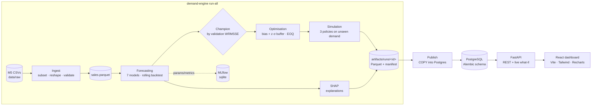

# Architecture

## System overview

The heavy computation (training seven models over six rolling origins) runs **offline**
once; the API serves precomputed results and only re-runs the cheap, vectorised
inventory simulation live (what-if analysis, < 1 s for ~2,000 series).

## Package layout (`src/demand_engine`)

| Package | Responsibility | Key modules |
|---|---|---|
| `config.py` | Single typed source of all settings (`pydantic-settings`, env-overridable) | `Settings`, `get_settings` |
| `data/` | Load, subset, reshape, validate, split | `loader`, `subset`, `transform`, `validation`, `splits`, `synthetic` |
| `features/` | Leakage-safe features | `calendar`, `price`, `lags`, `origin`, `builder` |
| `models/` | Common `Forecaster` interface + implementations | `base`, `statistical`, `lgbm`, `registry` |
| `evaluation/` | Metrics, rolling-origin backtesting, SHAP | `metrics`, `backtest`, `explain` |
| `optimization/` | Inventory maths, policies, simulator, scenarios | `formulas`, `uncertainty`, `policies`, `simulator`, `scenario` |
| `pipelines/` | Orchestration, artifacts, MLflow, publishing, CLI | `ingest`, `forecasting`, `optimize`, `run_all`, `publish`, `cli` |
| `api/` | FastAPI app, schemas, repository, live simulation | `main`, `routes`, `schemas`, `repository`, `simulation_service`, `db/` |

Dependencies point one way: `api → pipelines → optimization/evaluation → models → features → data`.
Numerical code (`optimization`, `evaluation.metrics`, `features`) is made of small pure
functions; I/O lives at the edges (`pipelines`, `api.repository`, `api.db`).

## Key design decisions

1. **One forecaster contract.** `Forecaster.fit(history)` / `predict(future)`; the base
   class drops `y` from `future` before the model sees it and enforces the output contract
   (one row per request, non-negative, `lo <= yhat <= hi`). Every model is therefore
   interchangeable in backtests, the optimiser and the API.
2. **Leakage safety by construction and by test.** Fixed lags are `>= horizon`; "origin"
   features read only demand at or before the forecast origin. Unit tests perturb future
   targets with random values and assert that every feature of the forecast window is
   bit-for-bit identical.
3. **Honest evaluation.** Validation folds pick the champion; test windows are only used
   for reporting and the simulation. Inventory policies may only use the forecast issued
   at the latest cut-off before each simulated day (no look-ahead).
4. **Artifacts are the contract between pipeline and serving.** Each run writes Parquet +
   a JSON manifest (written last = run complete). `publish` loads a run into PostgreSQL
   in one transaction using `COPY` (~1.5 M rows in seconds) and prunes old runs.
5. **Live what-if without retraining.** The API caches the simulator inputs of a run in
   memory; changing service level, lead time or costs recomputes safety stock, reorder
   points, EOQ and the full day-by-day simulation for every SKU-store. An integration test
   asserts that the API's re-simulation reproduces the pipeline's stored results exactly.
6. **Runs anywhere.** `docker compose up` for the full stack; `demand-engine demo` for an
   embedded PostgreSQL (no Docker); `demand-engine synthetic` for an offline dataset that
   mimics M5's file formats (also used by every test, so CI needs no download).

## Database schema

All result tables are keyed by `run_id` (first column of every composite primary key,
`ON DELETE CASCADE` to `pipeline_runs`):

| Table | Grain | Purpose |
|---|---|---|
| `pipeline_runs` | run | metadata, headline KPIs, settings (no secrets) |
| `series` | run × SKU-store | catalogue, demand class, demand rates |
| `model_scores` | run × split × model | leaderboard |
| `demand_history` | run × series × day | chart history + test actuals |
| `forecasts` | run × model × series × day | champion & baseline test forecasts |
| `validation_forecasts` | run × model × series × day | error statistics for safety stock |
| `inventory_policies` | run × series | SS, ROP, Q recommendation |
| `portfolio_results` / `series_results` | run × policy (× series) | simulation KPIs |
| `sensitivity_points` | run × service level × policy | cost/service trade-off |
| `feature_importance` / `shap_local` | run × feature (× series) | explainability |

## Quality gates

`ruff check`, `ruff format --check`, `mypy --strict` and `pytest` (unit + PostgreSQL
integration) run on every push in GitHub Actions, alongside the frontend's `oxlint`,
`tsc`, `vitest` and production build, and a Docker image build.
